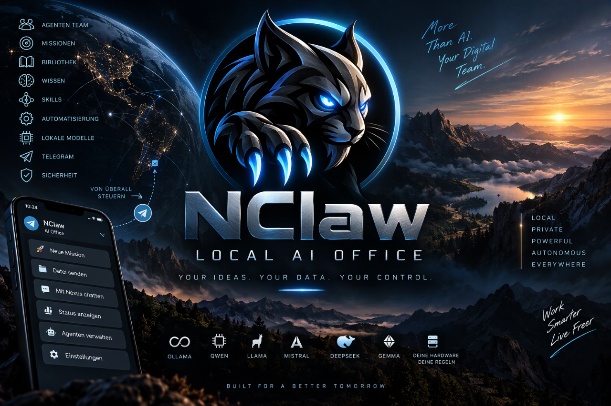

# NClaw - Local First AI Office Operating System

> **Implementierungsstatus (V1, 15.11.2026):** Die nachfolgenden Abschnitte beschreiben das Zielbild. Sie sind nicht automatisch ein Nachweis bereits implementierter Funktionen. Der aktuelle Entwicklungsstand ist im Feature-Branch [feat/nclaw-v1-core](https://github.com/roman181/NClaw2/tree/feat/nclaw-v1-core) dokumentiert. Implementiert sind dort derzeit ein FastAPI-Grundgerüst, SQLite-Missionsspeicher, Missionsanlage und Statusänderungen über die API, ein Dashboard mit Formular und Live-Missionsliste, eine Agenten-Registry mit einem nicht ausführenden Nexus sowie erste API-Tests und ein GitHub-Actions-Workflow. Telegram, Ollama, Sandbox-Ausführung, Langzeitgedächtnis, Freigaben und die übrigen Agenten sind noch offen.


<div align="center">
  
  
  **Dein persönliches AI-Office – vollständig lokal, vollständig unter deiner Kontrolle**
  
  []()
  []()
  []()
  []()
</div>

---

## 📋 Inhaltsverzeichnis

- [Vision](#-vision)
- [Kernprinzipien](#-kernprinzipien)
- [Benutzererlebnis](#-benutzererlebnis)
- [Remote Nutzung](#-remote-nutzung)
- [Hauptagenten](#-hauptagenten)
- [Telegram Dashboard](#-telegram-dashboard)
- [Systemarchitektur](#-systemarchitektur)
- [Mission System](#-mission-system)
- [Langzeitgedächtnis](#-langzeitgedächtnis)
- [Skill Factory](#-skill-factory)
- [Sicherheit](#-sicherheit)
- [Roadmap](#-roadmap)
- [Installation](#-installation)

---

## 🌟 Vision

**NClaw ist ein autonomes, lokales AI-Office-System.**

Der Nutzer kommuniziert ausschließlich über Telegram. Alle Modelle, Daten, Agenten, Dateien und das Gedächtnis laufen lokal auf dem eigenen Laptop oder PC.

NClaw arbeitet wie ein digitales Unternehmen mit spezialisierten Agenten, die Aufgaben übernehmen, Wissen sammeln, Projekte verwalten und kontinuierlich besser werden.

---

## 🎯 Kernprinzipien

| Prinzip | Beschreibung |
|---------|--------------|
| **Local First** | Alle Daten und Modelle bleiben auf deinem Gerät |
| **Datenschutz** | Keine Cloud, keine externen Server |
| **Telegram als Fernsteuerung** | Steuere dein AI-Office von überall |
| **Kontrollierte Autonomie** | Du behältst die Entscheidungsgewalt |
| **Sandbox vor Ausführung** | Sichere Testumgebung für alle Aktionen |
| **Nachvollziehbarkeit** | Alle Aktionen werden protokolliert |
| **Modulare Agentenarchitektur** | Erweiterbar und anpassbar |
| **Langzeitgedächtnis** | NClaw lernt und erinnert sich |
| **Erweiterbares Skill-System** | Neue Fähigkeiten durch Skills |

---

## 🚀 Benutzererlebnis

### Installation

```
User startet NClaw
        ↓
Einzige Eingabe: Telegram Bot Token
        ↓
NClaw richtet automatisch ein:
  ✓ Telegram Verbindung
  ✓ Besitzerkonto
  ✓ Sandbox
  ✓ Bibliothek
  ✓ Langzeitgedächtnis
  ✓ Standardagenten
  ✓ Ollama Anbindung
  ✓ Lokale Modelle
  ✓ Backup-System
```

---

## 📱 Remote Nutzung

```
┌─────────────┐     ┌─────────────┐     ┌─────────────┐     ┌─────────────┐
│  Smartphone │────▶│  Telegram   │────▶│ NClaw Bot   │────▶│   Laptop    │
│             │     │             │     │             │     │   Zuhause   │
└─────────────┘     └─────────────┘     └─────────────┘     └─────────────┘
                                                                   │
                                                            ┌──────┴──────┐
                                                            │   Lokale    │
                                                            │   Modelle   │
                                                            └─────────────┘
```

Der Benutzer kann jederzeit:
- 💬 Chatten
- 📎 Dateien senden
- 📋 Aufgaben erstellen
- 🤖 Agenten steuern
- 📊 Status prüfen
- ✅ Freigaben erteilen

---

## 🤖 Hauptagenten

### Nexus
> **CEO des AI Office**

| Aufgabe | Beschreibung |
|---------|--------------|
| Koordination | Überwacht alle Agenten und Missionen |
| Missionen verwalten | Startet, pausiert und beendet Missionen |
| Agenten steuern | Delegiert Aufgaben an Spezialisten |
| Entscheidungen | Trifft strategische Entscheidungen |
| Prioritäten | Setzt und verwaltet Prioritäten |

---

### Planner
> **Strategischer Planer**

- Ziele zerlegen
- Missionen planen
- Abhängigkeiten erkennen
- Roadmaps erstellen

---

### Sandmann
> **Dateispezialist & Sandbox-Verwalter**

- Dateianalyse
- ZIP Verarbeitung
- PDF Verarbeitung
- Bibliothek organisieren
- Duplikate entfernen

⚠️ *Arbeitet ausschließlich in Sandbox*

---

### Curator
> **Wissenskurator**

- Lernquellen auswerten
- Wissen strukturieren
- Skill Vorschläge erzeugen
- Quellen bewerten

---

### Scout
> **Research-Spezialist**

- GitHub Recherche
- Open Source Recherche
- Framework Suche
- Tool Recherche

⚠️ *Installiert niemals automatisch*

---

### Builder
> **Code & Skill Entwickler**

- Code erzeugen
- Skills erstellen
- Agenten erstellen
- Dokumentationen erzeugen

---

### Reviewer
> **Qualitätssicherung**

- Fehler finden
- Code prüfen
- Architektur prüfen
- Sicherheitsprüfung

---

### Observer
> **System-Monitor**

- CPU überwachen
- RAM überwachen
- GPU überwachen
- Agenten überwachen
- Modellstatus überwachen

---

### Archivist
> **Gedächtnis-Verwalter**

- Wissensverwaltung
- Historie
- Entscheidungen archivieren
- Langzeitgedächtnis

---

### Trainer
> **Academy-Manager**

- Academy verwalten
- Lernmaterial aufbereiten
- Skill Training

---

### Mentor
> **Lernqualität**

- Lernqualität bewerten
- Wissensvalidierung
- Qualitätskontrolle

---

### Security Agent
> **Sicherheitsbeauftragter**

- Rechtekontrolle
- Installer Prüfung
- Repository Prüfung
- Secret Scanning
- Sicherheitsregeln überwachen

---

## 📊 Telegram Dashboard

### Startseite

```
🏠 Home
🤖 Agenten
🎯 Missionen
📚 Bibliothek
🧠 Academy
🌳 Skill Baum
📊 System
⚙️ Einstellungen
💬 Nexus Chat
```

### Menü-Übersicht

| Menü | Funktionen |
|------|------------|
| **Dashboard** | Aktive Agenten, Missionen, Modellstatus, CPU, RAM, Wissensstand |
| **Missionen** | Laufende/abgeschlossene/geplante Missionen, Start/Pause/Fortsetzen/Abbrechen |
| **Agenten** | Status aller Agenten (Online/Offline/Beschäftigt) |
| **Bibliothek** | PDFs, ZIPs, Repositories, Skills, Wissen, Dokumentationen |
| **Academy** | Prompt-, Sicherheits-, Coding-, Agenten-, Forschungswissen |
| **Einstellungen** | Agenten aktivieren, Modelle wählen, Lernmodus, Sicherheitsstufen |

---

## 🏗️ Systemarchitektur

### Mission System

```
Analyse GitHub Repository
        ↓
    Planung
        ↓
    Analyse
        ↓
    Review
        ↓
    Bericht
        ↓
    Archivierung
```

### Langzeitgedächtnis

| Ebene | Beschreibung |
|-------|--------------|
| **Kurzzeit** | Aktuelle Aufgaben |
| **Arbeitsspeicher** | Aktive Missionen |
| **Langzeit** | Wissen |
| **Historie** | Vergangene Entscheidungen |

### Bibliothek

```
bibliothek/
├── pdfs/
├── repositories/
├── skills/
├── wissen/
├── projekte/
└── dokumentationen/
```

### Academy

```
academy/
├── prompts/
├── coding/
├── security/
├── agenten/
├── automation/
├── workflows/
├── research/
└── reasoning/
```

---

## 📚 Lernquellen

### Prompt Quellen
- Anthropic Prompt Library
- OpenAI Cookbook
- Gemini Prompt Gallery
- Learn Prompting
- DAIR Prompt Engineering Guide
- FlowGPT
- PromptHero
- AIPRM
- PromptBase
- SnackPrompt
- Prompts.chat
- Awesome ChatGPT Prompts
- Awesome Prompt Engineering

### Bildgenerierungswissen
- Lexica
- Civitai

### Agent Frameworks
- AutoGPT
- AnythingLLM
- Mobile Use
- Agent Reach
- OpenCode
- Weitere Open Source Projekte

---

## 🧪 Skill Factory

```
Wissen
   ↓
Sandbox Analyse
   ↓
Skill Entwurf
   ↓
Review
   ↓
Test
   ↓
Freigabe
   ↓
Skill Datenbank
```

### Agent Factory

NClaw kann neue Agenten vorschlagen:

```
Viele PDF Aufgaben
        ↓
PDF Specialist vorgeschlagen
        ↓
Benutzer bestätigt
        ↓
Agent wird erstellt
```

---

## 🔗 Wissensgraph

```
Prompt
   ↓
Skill
   ↓
Workflow
   ↓
Agent
   ↓
Mission
   ↓
Projekt
```

*Alles miteinander verknüpft.*

---

## 🛠️ Tool Layer

> ⚠️ **Agenten dürfen nie direkt handeln. Alles läuft über Tools.**

| Tool | Funktion |
|------|----------|
| FileTool | Dateizugriff |
| GitHubTool | Repository-Zugriff |
| TelegramTool | Kommunikation |
| MemoryTool | Gedächtnis-Zugriff |
| SearchTool | Suche |
| PDFTool | PDF-Verarbeitung |
| ShellTool | Shell-Befehle |
| ArchiveTool | Archiv-Verarbeitung |
| CodeTool | Code-Ausführung |

---

## 🧠 Modellmanager

### Unterstützte Modelle

| Modell | Status |
|--------|--------|
| Qwen | ✅ |
| Llama | ✅ |
| Gemma | ✅ |
| DeepSeek | ✅ |
| Mistral | ✅ |

*Spätere Modelle können ergänzt werden.*

### Zwei Modell Debatte

```
┌─────────┐         ┌─────────┐
│ Builder │◄───────►│Reviewer │
└─────────┘         └─────────┘
```

**Ziel:**
- Bessere Entscheidungen
- Weniger Fehler
- Bessere Codequalität

### TokenGuard

> Überwacht Kontext und Modellwechsel

```
Bei 90% Kontext-Auslastung:
        ↓
Projektstatus speichern
        ↓
JSON Snapshot erzeugen
        ↓
Neues Modell übernimmt
        ↓
Nahtlose Fortsetzung
```

---

## 🔒 Sicherheit

### Sicherheitsstufen

| Stufe | Farbe | Erlaubte Aktionen |
|-------|-------|-------------------|
| **Grün** | 🟢 | Lesen |
| **Gelb** | 🟡 | Dateien ändern |
| **Orange** | 🟠 | Code ausführen |
| **Rot** | 🔴 | Löschen, Git Push, Cloud, Externe Aktionen |

> ⚠️ **Rote Aktionen immer mit Freigabe!**

### Approval System

```
Telegram Nachricht:

🔔 Aktion angefordert

Agent: Sandmann
Aktion: Repository Import
Risiko: Niedrig

[✅ Erlauben] [❌ Ablehnen] [⏰ Später] [📄 Details]
```

---

## 🔄 Research Loop

```
Scout
   ↓
Quellen finden
   ↓
Curator analysiert
   ↓
Trainer erstellt Wissen
   ↓
Reviewer prüft
   ↓
Sandbox Test
   ↓
Benutzerfreigabe
   ↓
Academy
   ↓
Skill Factory
   ↓
Bibliothek
```

### Evolution Engine

```
Idee
   ↓
Simulation
   ↓
Sandbox
   ↓
Review
   ↓
Messung
   ↓
Freigabe
   ↓
Übernahme
```

### Digital Twin

NClaw lernt:
- Arbeitsweise
- Projekte
- Programmiersprachen
- Vorlieben
- Tools
- Zeitverhalten

*Dadurch verbessert sich die Planung.*

---

## 📈 Observer Dashboard

| Metrik | Beschreibung |
|--------|--------------|
| CPU | Prozessorauslastung |
| RAM | Arbeitsspeicher |
| GPU | Grafikkarte |
| Speicher | Festplattennutzung |
| Missionen | Aktive/Ausstehende |
| Modelle | Status der Modelle |
| Agenten | Agenten-Status |
| Temperatur | Systemtemperatur |
| Laufzeiten | Uptime |
| Logs | Systemprotokolle |

---

## 💾 Backup System

Automatische Sicherung von:

- ✅ Konfiguration
- ✅ Wissen
- ✅ Bibliothek
- ✅ Skills
- ✅ Agenten
- ✅ Projekte

> ⚠️ *Vor kritischen Änderungen wird immer gesichert.*

---

## 🗺️ Roadmap

### Phase 1
- ✅ Nexus
- ✅ Telegram Bot
- ✅ Ollama
- ✅ Sandbox
- ✅ Memory
- ✅ Approval System

### Phase 2
- ✅ Sandmann
- ✅ Bibliothek
- ✅ Missionssystem
- ✅ Dashboard

### Phase 3
- ✅ Curator
- ✅ Academy
- ✅ Skill Factory
